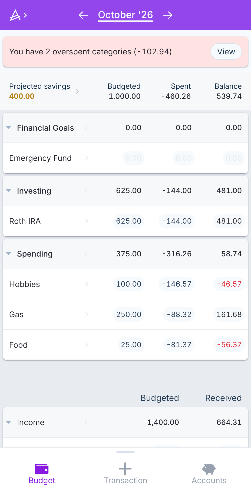
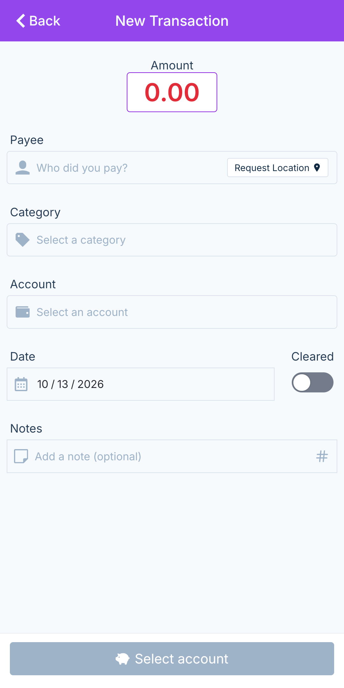
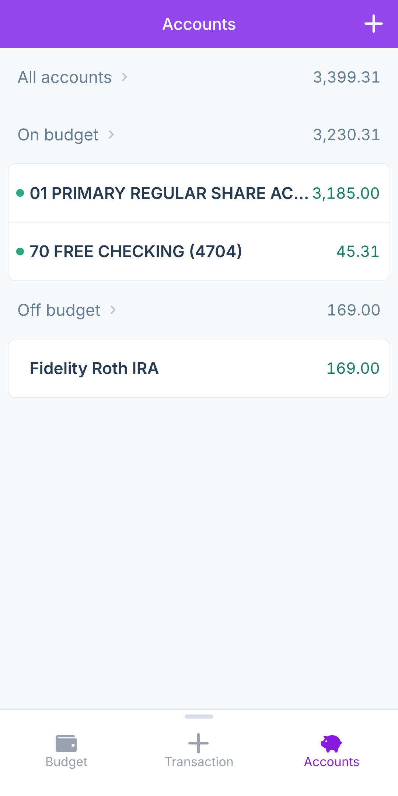
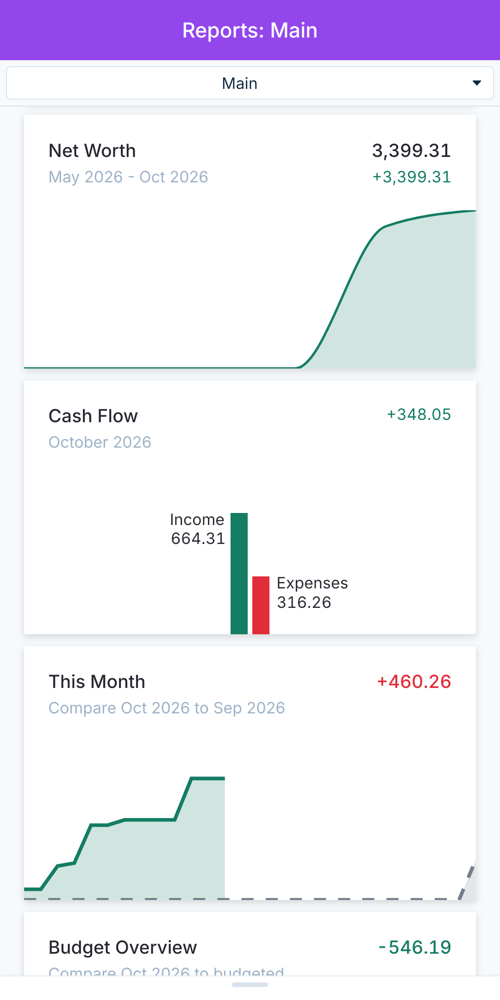

# Actual-Android

A lightweight Android client for self-hosted [Actual Budget](https://actualbudget.org/) instances, built with Kotlin and Mozilla GeckoView.

Open your budget in a dedicated app with no browser toolbar. Configure preferred and fallback servers, keep your login and local browser data, and connect over your LAN, reverse proxy, or Tailscale/Headscale network.

**First release: 1.0.0.** Android 10/API 29 or newer; the downloadable APK targets arm64 devices. No Google Play Services, analytics, accounts for this wrapper, or hardcoded server address. Your own Actual server and its authentication still apply.

## Download

Download the signed APK from [GitHub Releases](https://github.com/AldogPlays/Actual-Android/releases). Use the release APK for updates; debug APKs built with another signing key cannot update it.

See the [1.0.0 release notes](docs/release-notes-1.0.0.md) and [build and signing instructions](docs/BUILDING.md).

## Screenshots

Click a screenshot to view it larger.

<table>
  <tr>
    <td align="center">
      <a href="docs/screenshots/budget.png">
        
      </a>
      <br>
      <sub>Monthly budget</sub>
    </td>
    <td align="center">
      <a href="docs/screenshots/new-transaction.png">
        
      </a>
      <br>
      <sub>New transaction</sub>
    </td>
  </tr>
  <tr>
    <td align="center">
      <a href="docs/screenshots/accounts.png">
        
      </a>
      <br>
      <sub>Accounts</sub>
    </td>
    <td align="center">
      <a href="docs/screenshots/reports.png">
        
      </a>
      <br>
      <sub>Reports</sub>
    </td>
  </tr>
</table>

## Features

- **Dedicated browser engine** — Bundled GeckoView, with no address bar, tabs or permanent app toolbar. Android system bars and keyboard insets are handled by the native container.
- **Flexible servers** — Preferred and optional fallback URLs, custom ports, path prefixes, LAN addresses and overlay-network hostnames.
- **Persistent configuration** — Server settings encrypted with an Android Keystore key; cookies, authentication and browser storage remain in the app's private Gecko profile.
- **Safe connection recovery** — Bounded reachability checks, network-change detection and native Retry/Configure Servers screens. Healthy pages are not reloaded just because the network changes.
- **Actual compatibility diagnostics** — Page-context checks for secure context, cross-origin isolation, SharedArrayBuffer, WebAssembly and storage/worker APIs, with engine version information.
- **Native integration** — Back gestures, launcher settings shortcut, file selection and confirmed downloads through Android document pickers.

## Getting started

1. Install the release APK and open **Actual Budget**.
2. Enter your **Preferred Server URL**, for example `https://actual.example.com:5006`. Optionally add a fallback URL.
3. Tap **Connect**, review the connection result, and open Actual. Sign in to your server as usual.
4. Open settings later by long-pressing the launcher icon and choosing **Servers & settings**. A two-finger hold inside the app is also available.

Actual requires a secure context and the server headers `Cross-Origin-Opener-Policy: same-origin` and `Cross-Origin-Embedder-Policy: require-corp`. Check **GeckoView diagnostics** if initialization fails. HTTP can be configured after an insecure-transport warning, but usually cannot meet Actual's requirements. Invalid TLS certificates are never bypassed.

## Connection and local data

The preferred server is checked first. When it is unavailable, a reachable fallback can be offered. Authentication pages and reverse-proxy redirects are reviewed rather than rejected based on page titles.

**Different origins have separate logins and local budgets.** Review an origin change before switching; you may need to log in and initialize the budget at the other address. Failover never clears or migrates budget data. Explicit browser-data deletion requires a destructive-action confirmation. Synchronize/export before deleting data or uninstalling.

## Privacy and security

- No Play Services, Firebase, telemetry collection, push integration, root or accessibility service.
- Only Internet and network-state system permissions; file access uses Android's document picker.
- TLS validation remains enabled. Unexpected navigation origins require approval; permissions other than persistent storage for the active server are denied.
- Optional engine telemetry, update services and speculative networking are disabled through the bundled runtime configuration. DNS, certificate infrastructure and resources requested by your pages may still make network connections; no packet-capture audit has been performed.
- Keys, passwords, local configuration, APKs and build output are excluded from source control.

See [configuration and privacy details](docs/USAGE.md) for storage boundaries, certificate handling and engine preferences.

## Testing and compatibility

The initial APK was reported working by the owner, who supplied the screenshots above. Linux builds, JVM tests, lint, APK signatures and alignment have been checked. This does not establish every device acceptance criterion: exact GrapheneOS version, runtime diagnostic results, synchronization, rotation and network transitions still need separately recorded tests. See the [validation record](docs/VALIDATION.md) and [GeckoView investigation](docs/COMPATIBILITY.md).

Popup OAuth that depends on `window.opener`, WebAuthn and native date/color prompts are not implemented. The bundled engine makes the APK approximately 200 MiB. Other architecture builds are documented.

## Building

Use JDK 17, Android SDK Platform **37.2** and build-tools **36.0.0**. Pinned dependencies: AGP 9.4.1, Gradle 9.6.0, Kotlin 2.4.20 and stable GeckoView 158.0.20261007201254.

```sh
./gradlew testDebugUnitTest lintDebug assembleDebug
```

Debug output:

```text
app/build/outputs/apk/debug/app-debug.apk
```

Builds and checks run locally. GitHub Actions is disabled for this repository, and no workflow files are included. Public release APKs are built and signed locally with the retained certificate; the private key stays outside Git. See [BUILDING.md](docs/BUILDING.md).

## Project

Inspired by [LubeLogger-Android](https://github.com/AldogPlays/LubeLogger-Android)'s native server setup and connection recovery. GeckoView replaces the WebView integration; origin-change safety and page-context diagnostics address Actual's local data and isolation requirements.

Actual-Android is an independent wrapper and is not an official Actual Budget application. Actual Budget and third-party dependencies retain their own names, licenses and attribution.

## License

Copyright 2026 Jeffrey Conton.

Original wrapper source is licensed under the [MIT License](LICENSE), matching Goveon. See [third-party notices](THIRD_PARTY_NOTICES.md). GeckoView is distributed under Mozilla's licenses, including MPL 2.0; its source and dependency notices remain available through [Mozilla](https://firefox-source-docs.mozilla.org/mobile/android/geckoview/). Screenshots illustrate the owner's app use and are not part of the wrapper source-code license grant.
